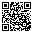
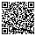
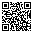

# StopPic

**Русский** | [English](README.en.md)

Бесплатная программа для скриншотов и записи экрана. Выделите область, добавьте подпись или стрелку, и картинка уже в буфере обмена. Экран можно записать в MP4 или GIF вместе со звуком.

Программа лёгкая: установщик весит несколько мегабайт, а сама она работает в трее и почти не занимает память. В интернет ничего не отправляет.

## Установка

1. Откройте страницу [Releases](https://github.com/paymepain/stoppic/releases/latest) и скачайте файл `StopPic_…_x64-setup.exe`.
2. Запустите его и следуйте шагам установщика.

Нужна Windows 10 или 11. Если в системе нет компонента Microsoft Edge WebView2 (обычно он уже есть), установщик скачает его сам.

Windows может показать окно «Система Windows защитила ваш компьютер». Так бывает с новыми программами без платной цифровой подписи. Нажмите «Подробнее» → «Выполнить в любом случае».

## Скриншоты

Нажмите `Ctrl+Alt+A`, и изображение на экране замрёт. Выделите мышью нужную область. Рамку можно двигать и тянуть за края.

- `Enter`, `Ctrl+C` или двойной клик — скопировать в буфер обмена
- `Ctrl+S` — сохранить в файл
- `Esc` или правая кнопка мыши — отменить
- `Ctrl+A` — выделить весь монитор; стрелки двигают рамку на 1 px, с `Shift` — на 10 px

Файлы сохраняются в папку `Изображения\Screenshots`. Клик по уведомлению открывает папку с файлом.

### Пометки на снимке

Под выделением появляется панель инструментов:

| Инструмент | Клавиша |
|---|---|
| Выбор и перемещение | `V` |
| Перо | `P` |
| Стрелка | `A` |
| Рамка | `R` |
| Маркер | `M` |
| Текст | `T` |
| Размытие (чтобы скрыть пароль, лицо и т. п.) | `B` |
| Нумерация 1, 2, 3… | `N` |

- Цвет и толщина запоминаются для каждого инструмента отдельно
- Если зажать `Shift`, стрелка ложится ровно под углом, кратным 45°, а рамка получается квадратной
- Инструментом «Выбор» любую пометку можно передвинуть, перекрасить или удалить (`Delete`). Текст правится двойным кликом
- `Ctrl+V` вставляет картинку из буфера обмена, кнопка на панели — из файла
- `Ctrl+Z` — отменить, `Ctrl+Y` — повторить

**Закрепить:** снимок остаётся маленьким окном поверх всех окон. Удобно, когда нужно что-то держать перед глазами. Закрыть его можно крестиком или клавишей `Esc`.

## Запись экрана

1. Нажмите `Ctrl+Alt+R` и выделите область (`Ctrl+A` — весь экран).
2. Если нужно, включите микрофон и звук компьютера.
3. Нажмите красную кнопку или `Enter`.

После отсчёта 3-2-1 появится небольшая панель с таймером, паузой и кнопкой «Стоп». Панель можно перетащить, в запись она не попадает. Остановить запись можно и тем же сочетанием клавиш. Пока идёт запись, значок в трее красный.

Формат (MP4 или GIF) и частота кадров (15, 30 или 60) выбираются в настройках.

## Настройки

Открываются из меню в трее («Настройки…»). Изменения применяются сразу.

- **Горячие клавиши:** нажмите на поле и введите новое сочетание. Если оно уже занято другой программой, StopPic предупредит. `↺` возвращает исходное сочетание
- **Сохранение:** папка для снимков и «Сохранять файл при копировании»
- **Запись экрана:** формат, частота кадров, микрофон и звук системы по умолчанию, отсчёт перед стартом
- **Общие:** запуск вместе с Windows, быстрый запуск снимка, язык

«Быстрый запуск снимка» держит программу наготове: снимок появляется мгновенно, но StopPic занимает чуть больше памяти. Если память важнее, отключите этот пункт.

Светлая или тёмная тема выбирается автоматически, как в Windows.

## Конфиденциальность

StopPic ничего не отправляет по сети. Снимки, записи и настройки хранятся только на вашем компьютере.

## Лицензия

StopPic бесплатен, исходный код открыт под лицензией [MIT](LICENSE.txt).
## Поддержать автора

Если программа пригодилась, поставьте ⭐ репозиторию на GitHub: так её проще найти другим. А если есть желание поддержать развитие финансово, можно воспользоваться любым способом ниже.

### DonationAlerts

https://www.donationalerts.com/r/paymepain

---

### Telegram (TON)

`UQBRPrNCafN_d41-4xq9FmCvPx0V94t6la3dY7G0l5_jOvRD`

---

### TronLink (TRON)

`TG3nnaoCSwct8YCZa8ciYHK3QUe7QETJiE`
